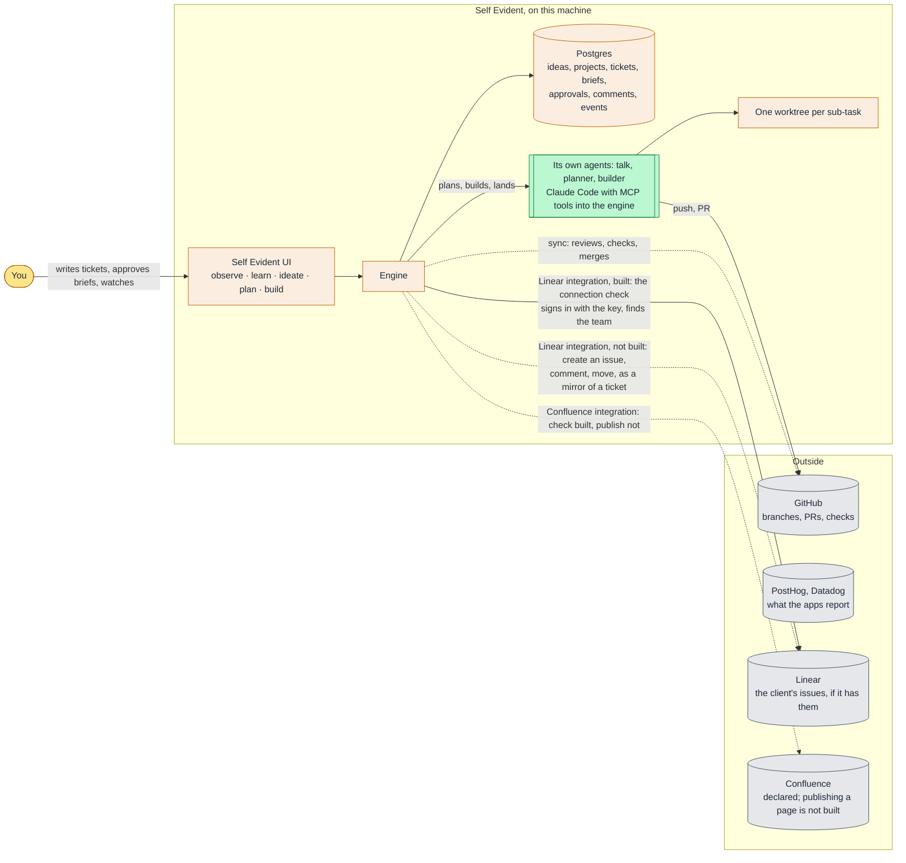
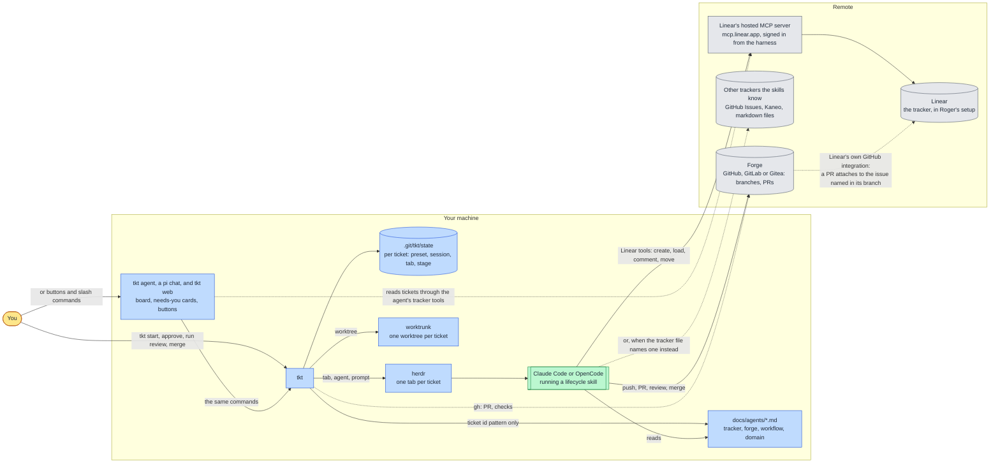
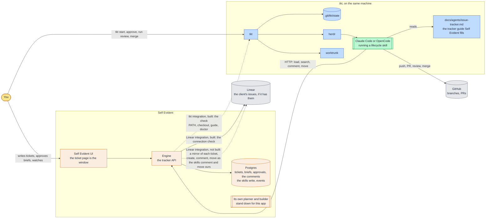

# What owns what: Self Evident, tkt, and the two together

Three ways to run the same loop, drawn so the ownership is visible (Sandy, 2026-11-08: "what owns what and how the
two are being used together … Self Evident on its own without tkt, tkt on its own including tkt web without Self
Evident, and then Self Evident with tkt as an integration"). The fixed point in every picture: **tickets live in
the tracker, never in tkt.** tkt keeps only what it knows about a running ticket (preset, session, tab, stage) in
the repo's `.git/tkt/state`; its board reads tickets through the agent, from wherever `docs/agents/issue-tracker.md`
says they live. tkt's own fit diagram is in its `docs/lifecycle.md`; these agree with it.

## 1. Self Evident on its own

Everything is Self Evident's: the tickets, the approval, the planner and builder, the worktrees, the build rows
and steps, the window. GitHub holds the code. The Linear integration is half there: its connection check is built (the solid
arrow), the mirror actions, create an issue, comment, move, are not (dotted). Confluence is the same.

## 2. tkt on its own, tkt web included (Roger's setup)

tkt owns the run: the worktree, the tab, the session, the stage, and the board that shows them. It never writes
the tracker. The skills do, following `docs/agents/issue-tracker.md`, and the tracker is wherever that file points:
for Roger, Linear through Linear's hosted MCP server. tkt web is a window onto tkt's state plus the tracker, driven
by the same slash commands you could type. Linear is reached two ways, neither through tkt: the skills call Linear's
hosted MCP server from the harness, and Linear's own GitHub integration attaches a pull request to the issue whose
id is in the branch name.

## 3. Self Evident with tkt switched on (ours)

Self Evident is the tracker: tickets, briefs, approvals and the skills' comments live in its database, and the
skills reach them over plain HTTP through the guide Self Evident fills. tkt still owns the run, as in picture 2,
and nothing of it is copied into Self Evident. The two touch at exactly two points: the guide in the repo, and the
check on the app's tkt page. The only path to Linear is Self Evident's Linear integration: the connection check
today, the mirror of each ticket (create, comment, move) once built. No arrow runs from tkt or the skills to Linear:
the tracker file names Self Evident, and the skills use only the connection it names. tkt web would
still work here, reading our tickets the way the skills do; we are not using it.

## What owns what

| | Self Evident alone | tkt alone | Self Evident + tkt |
|---|---|---|---|
| Tickets live in | Self Evident's Postgres | the tracker named in `docs/agents/issue-tracker.md`: Linear, GitHub Issues, Kaneo, markdown files | Self Evident's Postgres, as the tracker |
| Who writes tickets | you, ideas becoming tasks, the talk agent | you in the tracker's own UI, or create-ticket from the chat | the same as alone, plus the skills' comments |
| Who moves a ticket's state | the planner and builder runs, the GitHub sync | the skills, never tkt | the skills, through our API |
| The run: worktree, tab, session, stage | the engine's build rows, runs and steps | tkt, in `.git/tkt/state` | tkt, in `.git/tkt/state` |
| Code and PRs | GitHub | the forge: GitHub, GitLab or Gitea | GitHub |
| The window | Self Evident's UI | tkt web, the terminal, the plan viewer | Self Evident's ticket page; tkt web optional |
| Linear, and what talks to it | Self Evident's Linear integration: the check is built, the mirror (create, comment, move) is not | Linear is the tracker: the skills reach it through its hosted MCP server, and Linear's GitHub integration attaches PRs by branch name; tkt never talks to it | only Self Evident's Linear integration, as a mirror of our tickets; the skills and tkt have no path to it |
